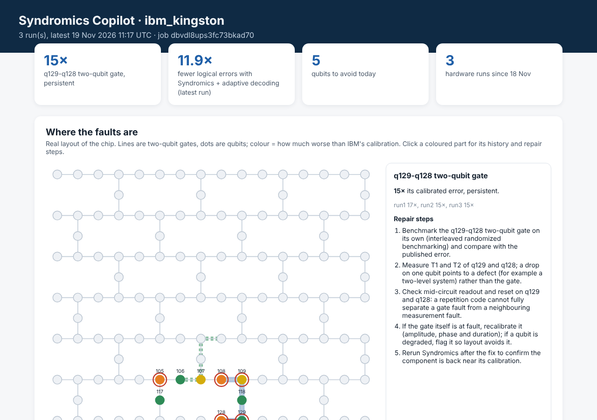

# Syndromics Copilot

[](https://github.com/wishapples/syndromics-copilot/actions/workflows/selftest.yml)

**Ask a quantum computer's noise data questions in plain English, see where it is broken, and get the steps to fix it.**

Syndromics Copilot is the operator side of [Syndromics](https://github.com/wishapples/syndromics). Syndromics measures a
quantum processor's real noise from its own error-correction data. Copilot turns those measurements into answers,
a clickable chip map, repair checklists and alerts, using NVIDIA NIM models for conversation.



Built on real data: three runs on IBM's 156-qubit `ibm_kingston` processor (18–19 November 2026) are included in
`samples/kingston`. Open [docs/example_report.html](docs/example_report.html) in a browser to try the report.

## What it does

| | |
|---|---|
| **Answers questions** | "Which qubits should I avoid today?", "How bad is q129-q128?", "What changed since yesterday?", "Explain it like a manager." |
| **Never makes numbers up** | The AI model calls tools that read the run files; every answer cites the run and job ID. |
| **Shows where the fault is** | A map of the real chip, coloured by how much worse each gate and qubit is than its calibration, plus the circuit that was run with the faulty gate marked. |
| **Says how to fix it** | A repair checklist per component (benchmarks, coherence checks, readout checks, recalibration) and a ready-to-send ticket for the hardware team. |
| **Adapts** | Keeps a health history of every component across runs (new, persistent, worsening, recovered) and remembers the team's preferences: alert thresholds, components to ignore, engineer or manager language. |
| **Watches** | Notices new results, compares them with earlier runs, and posts an alert to the console, a file, or a Slack or Microsoft Teams webhook. |
| **Suggests a better layout** | Finds a connected line of qubits on the real chip that avoids today's flagged qubits. |

Example (offline mode, real data):

```
you › how bad is q129-q128?
copilot › q129-q128 two-qubit gate
run1 (18 Nov, job dbukcjvf): 17× calibration
run2 (19 Nov, job dbvc3lv8): 15× calibration
run3 (19 Nov, job dbvdl8up): 15× calibration
```

## Quick start (Windows, macOS or Linux)

Requires the [.NET 10 SDK](https://dotnet.microsoft.com/download). No other packages.

```
git clone https://github.com/wishapples/syndromics-copilot
cd syndromics-copilot
dotnet run --project src/Syndromics.Copilot.Cli -- brief
dotnet run --project src/Syndromics.Copilot.Cli -- report
dotnet run --project src/Syndromics.Copilot.Cli -- chat
```

`report` writes `samples/kingston/syndromics_report.html`; open it in a browser and click any coloured part of the chip.

### Use NVIDIA NIM for conversation

Get a free API key at [build.nvidia.com](https://build.nvidia.com) (NVIDIA Developer Program; free endpoints are for
development and testing, not production). Then:

```
set NVIDIA_API_KEY=nvapi-...          (Windows)
export NVIDIA_API_KEY=nvapi-...       (macOS / Linux)
dotnet run --project src/Syndromics.Copilot.Cli -- chat
```

`NIM_MODEL` selects the model (default `meta/llama-3.3-70b-instruct`; any NIM chat model with tool calling works).
`NIM_BASE_URL` points to a self-hosted NIM or any OpenAI-compatible endpoint. Keep the key out of code and chats.
Without a key, or if the service is unreachable, Copilot answers from built-in rules, so a demo never fails.

### Use your own runs

Point `--runs` at the folder where you run the [Syndromics IBM demo kit](https://github.com/wishapples/syndromics/blob/main/docs/IBM_DEMO.md);
Copilot finds every `results` folder below it.

```
copilot --runs C:\ibmproject\syndromics-ibm-demo-kit report
copilot --runs C:\ibmproject\syndromics-ibm-demo-kit watch --every 60 --webhook https://hooks.slack.com/...
copilot check --backend ibm_kingston --line 117,105,106,107,108,109,118,129,128
```

`check` runs the kit as a preview; it uses QPU time only with `--confirm-qpu`.

## Commands

| Command | |
|---|---|
| `brief` | Findings, what changed, qubits to avoid and next steps on one screen |
| `report` | The visual HTML report (self-contained; can be emailed) |
| `ask "question"` / `chat` | One question, or a conversation |
| `ticket "q129-q128"` | A ticket draft for the hardware team |
| `watch [--every 30] [--webhook URL] [--once]` | Alerts when new results arrive |
| `check --backend B [--line ...] [--confirm-qpu]` | Runs the kit (preview unless confirmed) |

Options: `--runs`, `--audience engineer|manager`, `--out`, `--memory`.

## How it works

```
kit results (JSON) ─► RunStore ─► Analyzer ─► Tools ─► Agent ─► answer
                                     │                  │
                                     ├─► Report (HTML)  └─► NVIDIA NIM (tool calling) or offline rules
                                     └─► Watcher ─► alerts (console, file, webhook)
```

- `Analyzer` builds each component's history across runs from the Syndromics fits, classifies severity
  (≥8× critical, 3–8× high, 2–3× watch) and trend, and produces suggestions, repair checklists and tickets.
- `Tools` exposes 13 functions to the model (list runs, findings, history, qubits to avoid, alternative line, repair
  checklist, ticket, what changed, suggestions, remember, preferences, report).
- `Agent` runs the tool-calling loop against NVIDIA NIM's OpenAI-compatible API with plain `HttpClient`.
- `Memory` is a readable JSON file (`copilot_memory.json`) next to the runs.

## Honest limits

- A repetition code locates a fault to a qubit or pair; it cannot fully separate a gate fault from its neighbouring
  measurement. Copilot says so and its repair checklist covers both.
- Qubits never measured are unknown, not healthy. The suggested line only avoids measured problems.
- Copilot reads results; it does not run hardware unless you use `check --confirm-qpu`.

## Tests

```
dotnet run --project tests/Syndromics.Copilot.SelfTest
```

23 checks on the real Kingston data, the report, memory, offline answers, and the NIM tool-calling loop against a
local mock server. They run on every push (GitHub Actions).

## Licence

MIT. © 2026 Wish Apples Ventures Private Limited. Member of NVIDIA Inception.
